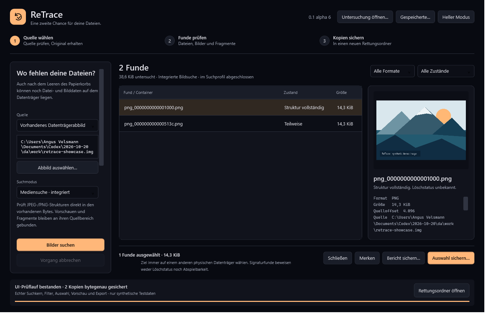

# ReTrace

<p align="center"><strong>Eine zweite Chance für deine Dateien.</strong><br>Ein lokaler Windows-Arbeitsplatz zum Suchen, Prüfen und Sichern von Datei-, Foto- und Videodaten.</p>

<p align="center"><a href="README.md"></a></p>
<p align="center">
  <a href="https://github.com/IamAngusU/ReTrace/releases/tag/v0.1.0-alpha.6"></a>
  <a href="docs/release.md"></a>
  <a href="THIRD-PARTY-NOTICES.md"></a>
</p>

Für Menschen, die fehlende Dateien auf Windows wiederfinden und Funde vor dem
Sichern prüfen möchten. Native C#/WPF-App, dunkles und helles Design, lokaler
Suchkern und mitgeliefertes PhotoRec. **Vorschauversion mit klaren Grenzen.**



<sub>Aufnahme der laufenden Windows-App mit selbst erzeugtem Testabbild; kein Nachweis einer realen Datenrettung.</sub>

## In drei Schritten starten

1. [Das vollständige Windows-ZIP herunterladen](https://github.com/IamAngusU/ReTrace/releases/tag/v0.1.0-alpha.6) und vollständig entpacken.
2. `ReTrace.exe` öffnen, Quelle wählen und die passende Suche ausdrücklich starten.
3. Funde prüfen und **Auswahl sichern** auf einen **anderen physischen Datenträger** verwenden.

**Niemals gerettete Dateien, Arbeitsordner oder Abbilder auf das Laufwerk schreiben,
von dem du retten möchtest.** Auch Download und Entpacken können gelöschte Daten
überschreiben. Ein anderer Laufwerksbuchstabe auf derselben Platte reicht nicht.
SSD-TRIM oder bereits überschriebene Bytes können eine Rettung verhindern.

Das portable Paket enthält die Laufzeit und PhotoRec. Kein Python, SDK, Konto
oder Internetdienst zur Benutzung nötig. Administratorrechte nur für Rohzugriff.

## Warum nicht Recuva, PhotoRec oder Windows File Recovery?

[Recuva](https://www.ccleaner.com/recuva) bietet eine etablierte Windows-Oberfläche.
[Windows File Recovery](https://support.microsoft.com/en-us/windows/experience/backup-recovery/windows-file-recovery)
ist Microsofts Kommandozeilenwerkzeug. [PhotoRec](https://www.cgsecurity.org/testdisk_doc/photorec.html)
ist der unabhängige Signaturrettungskern, den ReTrace unverändert mitliefert.

ReTrace passt für begrenzte Vorschauen, nachvollziehbare Bytebereiche, gespeicherte
Untersuchungen und geprüfte neue Kopien in einer nativen App. Es ist jünger und
enger begrenzt; es gibt keinen Nachweis einer höheren Rettungsquote. Der PhotoRec-
Modus verwendet PhotoRecs Rettungskern.

## Benutzen

1. `ReTrace.exe` aus dem vollständigen portablen Ordner öffnen.
2. **Quelle** wählen: Papierkorb, einen Ordner mit möglichen Kopien oder ein
   vorhandenes Datenträgerabbild. Der Papierkorb ist die Standardansicht;
   erst ein ausdrücklicher Suchstart liest den gewählten Bestand.
3. Die passende Suche starten. Ordner untersuchen reguläre Dateien einschließlich
   versteckter Container. Die native Suche bietet **Fotos**, **Videos** und
   **Alle Medien**. **Tiefensuche** verwendet das gepinnte PhotoRec 7.2. Dessen
   Profile Fotos, Videos, Dokumente oder alle Typen sind echte Suchoptionen; allgemeine Signaturfunde
   können Fehlkandidaten sein und bleiben ungeprüft.
4. Ganze oder teilweise lesbare Bilder ansehen, filtern und auswählen.
5. **Auswahl sichern** erzeugt einen neuen Rettungsordner. Jede aufgeführte Kopie
   wird mit SHA-256 geprüft. Vorhandene Dateien oder Ordner werden nicht ersetzt.

## Videos und gemischte Medien

Die native Videosuche untersucht MP4, QuickTime MOV und AVI unabhängig von der
Dateiendung. Sie prüft Containergrenzen, verschachtelte Video-Track-Header,
Medienbereiche und unterstützte Chunk-Adressen. Fotos und Videos teilen in
**Alle Medien** einen Quelldurchlauf. JPEG-Frames eines MJPEG-AVI können deshalb
zusätzlich als einzelne Bilder erscheinen. Der reine Videofilter blendet diese
aus. Ordner können auch Videos in versteckten Cache- oder .bak-Dateien finden.

Das Video-Profil setzt tatsächlich 256 MiB pro Fund; die erweiterte Grenze ist
1 GiB. Teilfragmente bleiben separat begrenzt. Größere Quelldateien erfordern ein
passendes Container-/Gesamtprofil. Grenzen und ausgelassene Bereiche werden
ausgewiesen. Die Videoansicht zeigt geprüfte Metadaten und Bytebereiche; sie
startet keinen Player und führt keine Funddatei automatisch aus.

Die PhotoRec-Videosuche aktiviert die tatsächlichen upstream-Formatfamilien
MOV/MP4, RIFF/AVI, MKV/WebM, ASF/WMV und MPEG. Familien können auch Audio- oder
andere verwandte Formate liefern. Eine gesonderte Option bewahrt `mov/mdat`-
Fragmente auf. Sie verbindet diese nicht blind mit beliebigen Headern.
Fragmentierte MP4s, fehlende Movie-Header und abgeschnittene Medien bleiben
Teilfunde. Ein strukturell vollständiger Container ist noch kein Nachweis, dass
alle Frames decodierbar oder die ursprünglichen Aufnahmen vollständig sind.

Gespeicherte Video-Untersuchungen lassen sich wie Foto-Untersuchungen wieder
öffnen, einzeln auswählen und sichern.

Auch ältere QuickTime-MOV-Dateien ohne `ftyp`-Atom werden nativ gesucht; dieses
Atom ist laut [Apple optional](https://developer.apple.com/documentation/quicktime-file-format/file_type_compatibility_atom).
Die Suche erkennt einen Beginn mit `moov`, `mdat` oder `wide` nur bei zusammenpassenden
Movie-, Video-Track-, Sample- und Chunk-Strukturen. Ein isolierter `mdat`-Block
reicht nicht. Beide Atomreihenfolgen und 32-/64-Bit-Chunk-Adressen werden geprüft.
Die genaue ursprüngliche Marke, vorangehende Füllbytes und nachfolgende optionale
Metadaten bleiben bei solchen Funden unbekannt. Innere Atome bereits erkannter
Videobereiche oder anderer `ftyp`-Container werden nicht als weitere alte MOVs
ausgegeben; JPEG-/PNG-Funde innerhalb von Medien bleiben separat sichtbar.

**Laufwerk als Abbild sichern** liest ein ausgewähltes Laufwerk in eine neue
Abbilddatei auf einem anderen erkannten Datenträger. Dafür kann ein ausdrücklicher
Neustart als Administrator über Windows-UAC nötig sein. Papierkorb-, Ordner- und
reguläre Abbilddateien benötigen diesen Rohzugriff nicht.

Möglichst wenig auf das betroffene Laufwerk schreiben. Ein zweiter Buchstabe
auf derselben Platte ist kein zweiter Datenträger. Für die Aufnahme prüft
ReTrace einzelne Disk-Extents und unterstützte direkte Speichertypen; unbekannte,
virtuelle, RAID- und Storage-Spaces-Konstellationen werden nicht automatisch
freigegeben. Das ist keine Erkennung beliebiger physischer Speichertopologien.
Aktive Laufwerke können sich während des Lesens verändern. Die Aufnahme ist
kein VSS-/Dateisystem-Snapshot und repariert oder sperrt das Quelllaufwerk nicht.

## Was diese Version kann

- Bilder und Fragmente aus regulären Raw-Abbilddateien bis **16 TiB** suchen;
  ein normaler Ordner enthält keine freigegebenen Sektoren gelöschter Dateien.
- JPEG-Marker sowie PNG-Struktur/CRCs prüfen. Der integrierte Suchlauf arbeitet
  mit Streaming und Dateisperren; Quelldatei-ID, Größe und Änderungszeit bleiben
  an die Auswahl gebunden. Er erkennt keine beliebigen Dateifragment-Ketten.
- PhotoRec verwirft beschädigte Funddateien bei aktivierter Fragmentoption nicht
  automatisch. Alle nummerierten `recup.*`-Ordner werden beobachtet. Originale
  Namen und Verzeichnisse bleiben beim Carving meist unbekannt.
- Bildvorschau nur für unterstützte Bilddaten, mit Dateigrößen-/Pixelgrenzen und
  begrenzter Decoder-Auflösung. Dokumente und Programme werden nicht ausgeführt.
- Kopien aus Quellbereichen oder aus dem privaten PhotoRec-Lauf sichern; ein
  gespeicherter PhotoRec-Bestand lässt sich auch ohne ursprüngliche Abbilddatei
  erneut öffnen und exportieren, wenn die aufbewahrten Funddateien die
  SHA-256-Prüfung bestehen.
- Laufwerksabbilder als neue Datei mit Protokoll anlegen und den geschriebenen
  Bestand unabhängig erneut per SHA-256 prüfen. Abbruch oder Lesefehler behalten
  einen ausdrücklich unvollständigen Bestand mit bekannter Präfixlänge.

## Papierkorb und weitere Fundquellen

Beim Start ist jetzt der **Windows-Papierkorb des aktuellen Benutzers** gewählt.
Eine ausdrückliche Suche liest die lokalen Papierkorb-Metadaten, zeigt Originalpfad,
Löschzeit, Größe und den Zustand des Dateipaars. **Auswahl sichern** kopiert die
gewählten regulären Dateien in einen neuen Ordner und prüft die tatsächlich
geschriebenen Bytes unabhängig mit SHA-256. Es entfernt keine Papierkorbeinträge
und verwendet den berichteten Originalpfad niemals als Schreibziel.
Verzeichniseinträge sind sichtbar, werden in diesem Profil noch nicht rekursiv gerettet.

**Ordner, Backups und Cache** durchsucht ausdrücklich gewählte lokale Ordner
rekursiv, einschließlich versteckter regulärer Dateien und Bilddaten in Containern
unabhängig von der Dateiendung. So können etwa JPEG-/PNG-Kopien in .bak-, .tmp-
oder Cachedateien auffallen. Die Vorschau und Sicherung bleiben an die genaue
Quelldatei und ihren Bytebereich gebunden. Ein Cachebild kann eine verkleinerte
Vorschau sein; Signaturfunde belegen keinen früheren Löschvorgang.

Das Ordnerprofil liest standardmäßig höchstens 256 Dateien, 512 MiB Quelldaten,
128 MiB pro Container und acht Verzeichnisebenen. Ausgelassene Bereiche und
Abbruchgrenzen ergeben ausdrücklich partielle Ergebnisse. Links, alternative
Datenströme und Archive werden durch dieses Profil nicht verfolgt oder entpackt.

Nach dem Leeren des Papierkorbs können die Abbildsuche und PhotoRec verbliebene
Signaturen untersuchen. Frühere Versionen und File-History-Backups können weitere
Quellen sein; sie werden hier nicht automatisch abgefragt.

## Untersuchungen später fortsetzen

**Untersuchung speichern** legt einen neuen, begrenzten JSON-Bericht an.
**Öffnen** liest ihn nach einem Neustart wieder ein; **Sammlung** verwaltet
gespeicherte Fälle unter dem eigenen Benutzerprofil. Es wird dabei kein
Suchlauf wiederholt. Dateibindung und Fundbereiche werden geprüft, gespeicherte
PhotoRec-Funddateien zusätzlich vollständig gehasht. Für native Fundbereiche
erfolgt die erneute SHA-256-Prüfung vor dem Sichern der gewählten Bytes.

Fehlt die Quelle oder wurde sie geändert, bleibt der Bericht lesbar und die
Rettung wird gesperrt. **Schließen** leert die aktuelle Ansicht. Das Löschen
aus der Sammlung entfernt ausschließlich diese Metadaten; Abbilder, Funddateien
und bereits gerettete Kopien werden dadurch nicht gelöscht.

## Grenzen

Überschriebene oder per SSD-TRIM verworfene Inhalte, fehlende Verschlüsselungs-
schlüssel und beschädigte Zuordnungsdaten können Rettung verhindern. Carving
findet auch vorhandene oder eingebettete Kopien; der Löschstatus bleibt ohne
zusätzliche Dateisystembelege unbekannt. Ein teilweises JPEG kann lesbare Pixel,
nachfolgende fremde Bytes oder nur einen Fragmentanfang enthalten. ReTrace gibt
keinen erfundenen Prozentsatz „geretteter Originaldaten“ aus.

Integriert: maximal 10.000 Signaturprüfungen, 64 MiB pro vollständigem Kandidaten,
4 MiB pro Fragment und ein begrenztes aggregiertes Prüfvolumen. PhotoRec:
standardmäßig 1 Stunde Laufzeit, 10.000 Funddateien, 64 MiB je Fund und 4 GiB
Gesamtausgabe; diese Grenzen lassen sich in der Oberfläche ausdrücklich
anpassen. Fotos, Dokumente und alle unterstützten Typen sind getrennte Profile. Externe Ausgabegrenzen
werden beobachtet und können vor dem Prozessstopp kurz überschritten werden.
Für PhotoRec wird ein neuer, selbst gewählter Arbeitsordner benötigt; er enthält
Werkzeugkopien, Funddaten und den Bericht. Abbruch löscht diese Daten nicht.
Ein beendetes Profil garantiert weder alle Fundstellen noch Originalität.

## Entwickeln und prüfen

Windows 10/11 x64 und .NET-10-SDK; keine NuGet-Abhängigkeiten von Drittanbietern.

```powershell
dotnet run --project tests/ReTrace.Tests/ReTrace.Tests.csproj -c Release
dotnet build src/ReTrace.App/ReTrace.App.csproj -c Release
python scripts/fetch_components.py .tools
python scripts/publish.py D:\ReTrace\neuer-build --assets .tools
```

Das Build-Skript benötigt Python 3.11+; die fertige App nicht. Die beiden
Originalarchive im Komponentenordner müssen die Pins aus
[THIRD-PARTY-NOTICES.md](THIRD-PARTY-NOTICES.md) erfüllen. Keine Binärarchive,
Datenträgerabbilder oder privaten Funddaten gehören in das Git-Repository.

Validierung: [docs/validation.md](docs/validation.md).

[Build-Herkunft](https://github.com/IamAngusU/IamAngusU/blob/main/ci.md) ·
[CI-Läufe](https://github.com/angusu-de/ReTrace/actions) ·
[Mitgelieferte Lizenzen und Quellen](THIRD-PARTY-NOTICES.md).

<p align="center"><a href="https://github.com/IamAngusU/icon-marquee"></a></p>

ReTrace entstand aus dem Wiederherstellungs-Workflow von TraceLedger und ist ein eigenständig nutzbares Produkt.
